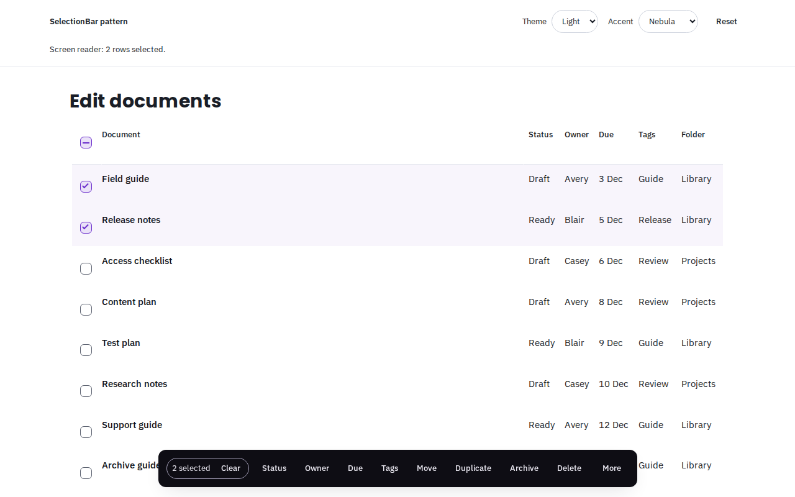

# SelectionBar from the bulk action pattern

Open `prototype.html` in the review viewer. It is one document with embedded fonts, kit styles, and scripts.
The prototype needs only `sandbox="allow-scripts"`. It has no nested frame, frame sizing script, storage, or network request.

This design is for the kit owner’s review of selected-row actions.
Read the table, select rows, then change those rows from the floating bar.
The table stays a table at narrow widths. The bar keeps Status visible and moves extra actions into More.
The controls at the top belong to the review page.

The source is [sketch-skill PR 66](https://github.com/asabirov/sketch-skill/pull/66), head `9adc05536193fb6354bec6eacce4647873fd31d5`.
The files read were `library/content/bulk-action-bar/pattern.md`, `sketch.html`, and `transitions.json`.
The issue is [SelectionBar 902](https://github.com/apliteni/apliteni-ui/issues/902).
The prior design is [the first variants](../902-selection-bar/README.md), commit `df23121812816c868f897416441512f033f3b01e`.
No existing kit component was changed. The pictures show a proposed component, not a kit showcase.

## Recommendation and owner decisions

Recommend this pattern when people change one field at a time and continue with the same selected rows.
It keeps one bar line at the requested widths. There is one prototype because the pattern settles the interaction.
The owner must decide these changes before a kit build. This branch does not change the issue.

| Proposed issue change | Issue 902 | Pattern shown | Owner decision |
| --- | --- | --- | --- |
| Commit timing | Stage several fields, then call one Apply. | Each pick applies immediately. Selection stays. | Choose one transaction model. Recommend immediate picks for this pattern. |
| Field trigger | Placeholder first, then the chosen value. | The field name stays visible after each pick. | Accept permanent names or retain the issue’s value display. |
| Field width | Every field has the same fixed 9rem width. | Each name takes its natural button width. Picks never change it. | Accept natural widths or retain equal widths. |
| Narrow layout | Two rows with all fields visible. No More. | Status stays visible. More contains the other fields and actions. | Accept More or retain visible fields. Recommend More for this pattern. |
| Clear and keyboard order | Clear follows Apply. | Clear sits beside the count, before field buttons. | Accept the new order. The count remains outside the tab order. |
| Additional actions | Fields, Apply, and Clear only. | Duplicate, Archive, Delete, Export, and Copy links. | Decide which actions the general component accepts. |
| Apply and busy state | Apply is the only primary action. Busy disables the whole bar. | No Apply button or staged state. Delete asks for confirmation. | Replace the Apply API and define pending and error behavior before implementation. |
| Accessible field name | Field name and pending value. | Field name identifies an immediate action picker. | Accept names without a pending value. Announce the result separately. |

The bar keeps the issue’s named region role and Tab order between controls.
It does not claim the sketch’s toolbar role.
The hidden count region remains polite and atomic. Clear and Escape return focus to the table’s Select all control.
Escape closes a picker first. A second Escape clears the selection.
Menus retain the page theme. The bar retains the opposite theme and the page’s accent family.
The bar has no sum. Its end space keeps the last row uncovered.

## Kit conflict and adaptations

The pattern uses wordless Archive and Delete buttons. The kit’s Iconography rule says:

> **Rule:** Remove a control’s label only for an action on the closed list.

The Button labels rule also says:

> **Rule:** Drop a button’s words only when its glyph is learned everywhere, its action is on the closed list, and its name reaches assistive technology and a hover title.

Archive and Delete are absent from the closed list in `guidelines/iconography.md`.
This prototype follows the kit and keeps words for Duplicate, Archive, and Delete.
The owner can follow the kit, approve a recorded exception, or change the closed list in a separate kit decision.
Recommend words because each action remains clear without hover.

Due replaces Due date to match the table header.
Clear replaces the sketch’s x with a visible word inside the count group. This meets the brief’s Clear requirement.
The table keeps its header and scroll region on a phone, as Dense tables requires.
The prototype uses kit spacing, corners, fonts, and opposite-theme colors instead of sketch values.
The prototype uses the kit’s 860px and 560px steps instead of the sketch’s 1000px and 600px steps.
The pattern’s 200ms estimate is not a token. The bar and picker entrances and departures use `--dur-med` at 250ms and `--ease`.
Reduced motion changes immediately. Counts update immediately.

The new bar paint is a design proposal. Its local paint must become an approved kit part before app reuse.
No story CSS allow-list changed. `stories/story-css.test.js` and `react/src/story-css.test.ts` were not run.
This branch changes no package or story. The brief excludes a PR and ship check.

## Inverse token proposal

Reuse the first variants’ opposite-theme token mapping. No token file changes in this branch.

| Proposed token | Light page, dark bar | Dark page, light bar | Existing source |
| --- | --- | --- | --- |
| `--inverse-bg` | `#0e0d14` | `#ffffff` | Opposite `--bg` |
| `--inverse-text` | `#e9e7f0` | `#1a1e27` | Opposite `--text` |
| `--inverse-strong` | `#ffffff` | `#0c0e13` | Opposite `--strong` |
| `--inverse-muted` | `#a29db6` | `#5c6270` | Opposite `--muted` |
| `--inverse-edge` | `#a29db6` | `#5c6270` | Opposite `--muted` |
| `--inverse-hover` | `#2d293c` | `#eef0f5` | Opposite `--surface-3` |
| `--inverse-accent` | Same accent family in dark | Same accent family in light | Opposite `--accent` |
| `--inverse-shadow` | Page `--elev-drop` | No shadow | Issue 902’s inverse treatment |

The count group uses the strong edge proposal. Action buttons are ghost buttons, so they need no field edge.
The light bar has an outer edge. The dark bar has the page’s drop shadow.
Focus uses the inverse accent with the kit’s 2px band and 1px clear gap.
The source values were checked in `src/tokens/tokens.css` and `src/tokens/accents.css`.
The browser measurements for all eight theme and accent cells are in `verification.json`.

## States and limits

Address hashes open `#selected`, `#none`, `#picker-open`, `#applied`, `#all-selected`, `#more-open`, and `#confirm-delete`.
Use `?theme=dark&accent=ocean#picker-open` to open another theme and accent.
A document link opens a local record view. Back returns to the same selection.

Status, Owner, Due date, Tags, Move, Archive, and Delete change fabricated local records.
Duplicate, Export, and Copy links show explicit preview feedback. They create no stored record, file, or clipboard content.
Reset restores the fabricated records. Reloading also resets them.
There is no server, persistence, network failure, or slow-operation simulation.
The source pattern defines no pending or error state. These need a decision before the kit build.
A real screen reader was not used. The visible Screen reader line mirrors the hidden announcement for review.

## Kit rules

| Screen part | Rule and page | Checked source |
| --- | --- | --- |
| New component boundary | Composition checks in `AGENTS.md`, Changes. | `react/src/FilterBar.tsx`; `src/styles/layout.css`, `.ui-float-bar`. |
| Button names and shapes | Keep the words, Earn a wordless button, Give every control one shape in `guidelines/button-labels.md`. | `src/styles/button.css`. |
| Wordless actions | Icon-only controls in `guidelines/iconography.md`. | The closed list in that guideline. No new glyph was added. |
| Pickers | Open a panel at its control and Add dropdown search in `guidelines/component-choice.md`. | `src/styles/dropdown.css`; `react/src/Dropdown.tsx`. |
| Destructive action | Interrupt with a question and Make the committing action stand out in `guidelines/component-choice.md`. | `src/styles/confirm.css`; `react/src/Confirm.tsx`. |
| Feedback | Show lasting conditions in `guidelines/component-choice.md`. | `react/src/Toast.tsx`. Local feedback stays above the bar. |
| Table | Surface, density, content-width, overflow, top-align, and states in `guidelines/dense-tables.md`. | `src/styles/table.css`. |
| Theme and contrast | Semantic tokens, Accent contrast, and Theme checks in `guidelines/colour-and-theming.md`. | `src/tokens/tokens.css`; `src/tokens/accents.css`. |
| Accent use | Give accents a job in `guidelines/density-and-accents.md`. | `src/styles/button.css`. There is no primary Apply button. |
| Type and surfaces | Typefaces, Text ink, Control corners, and Elevation in `docs/foundations.md`. | `src/styles/base.css`; `src/tokens/tokens.css`. |
| Gaps and touch | Use two gaps and Widen inner gaps on a touch phone in `guidelines/spacing.md`. | `src/styles/tap-zone.css`. Small controls keep their drawn size. Transparent phone targets use declared gaps. |
| Focus | Focus rings in `guidelines/state-set.md`; Focus ring contrast in `guidelines/accessibility-floor.md`. | `src/styles/base.css`; `src/styles/button.css`. |
| Accessibility | Minimum target size, Tap target on a phone, Body contrast, Measurable pairs, and Keyboard first in `guidelines/accessibility-floor.md`. | Named controls, live region, and browser checks in this prototype. |
| Motion | Move after load, Match duration to motion, Use the kit curves, and Honor reduced motion in `guidelines/motion.md`. | `src/tokens/tokens.css`; `src/styles/reduced-motion.css`. |
| Copy | Keep controls short and Cut filler in `guidelines/text-length.md`. | Prototype labels and `notes.md`. |

## Sources

The declared design system is the kit’s foundations, components, guidelines, and exported tokens, as `AGENTS.md` requires.
The design skill pages read were App screens, Components, Layout, Colour, Typography, Motion, Picks, Content and words, and AI look.
IBM Plex Sans and Poppins come from the first prototype. Their OFL notices are included.
No diagram was needed. The pattern supplied the interaction, so no new sketch library file was made.
See `review.md` for the self-review and evidence limits.
