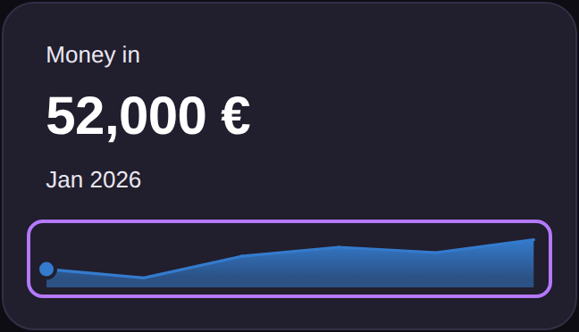
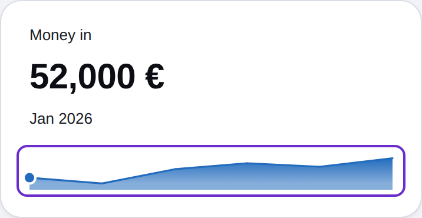
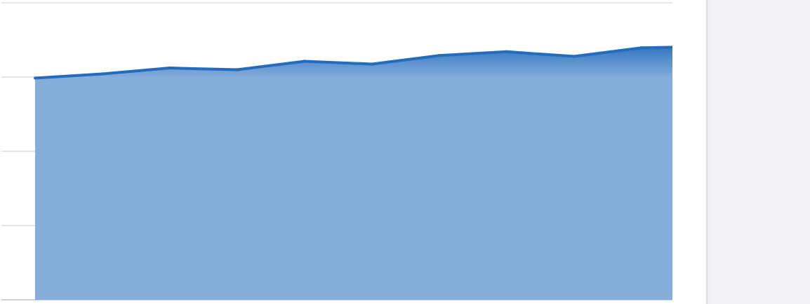
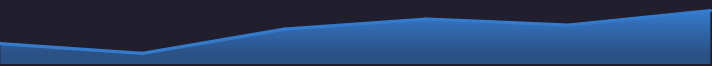
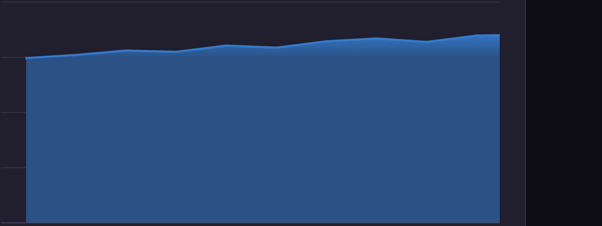

# builder-ui-r6-charts: chart look and hover that drives the figure (#768)

Version 0.160.0. All data in the prototypes and stories is fabricated.

## Fix round 1

The coordinator's check found four defects. Each row gives the fix and its measurement. I measured in headless Chromium, light and dark, at 390, 720 and 1280 px, after `document.fonts.ready`.

### 1. The spark runs from the text edge to the card's inner edge

A spark of lines now puts its first point at x 0 and its last point at the plot width. A spark with bars still centres each bar in its column. The frame and the scroller reach one `--space-2` step past each edge, so the end dots and the focus ring are not cut.

| Width | First point x against title x (each card) | Spread |
| --- | --- | --- |
| 390 | 41 / 41 | 0.0 px |
| 720 | 41 / 41, 275.7 / 275.7, 510.3 / 510.3 | 0.0 px |
| 1280 | 41 / 41.2, 462.3 / 462.5, 883.7 / 883.8 | 0.2 px at most |

The last point against the card's inner edge: 396.2 against 396.3 at 1280 (0.1 px). The spread is 0.0 px at 720 and 390. The limit was 0.5 px.

The chart target gate found a defect in my first version. Each end target was held inside the plot, so at 320 and 390 it ran over its neighbour and owned only 13.2 px and 15.4 px. Now each point owns an equal share of the plot width, as before this round, and each point stays inside its share. A new test fails when the targets overlap again. I hovered the centre of every target of all three cards at 390, 720 and 1280, light and dark: every one shows the dot and the right figure, and every target is 24 px wide.

### 2. Every card in the band has a spark

I gave "Net result" a spark from the same months, with net = money in minus money out. Its rest figure is 140,100 €. All three cards are 184 px high. The `a-band-not-a-card` specimen on the Stat bands page had the same defect, so its "Cost" card now has a spark too.

Why a spark on every card, not on none: the finance dashboard already traces net, and a spark answers "which way is it moving" for each figure. PR #552 also found that a tile with no trace is 48 px short beside the traced tiles. Removing all sparks would drop the hover that the owner asked for.

### 3. The hover dot reads in both themes

The dot is now radius 5: a 2 px ring in the ground colour around a centre of radius 4 in the series tone.

| Theme | Ring | Centre |
| --- | --- | --- |
| Light | #ffffff | rgb(35, 108, 189) |
| Dark | rgb(33, 30, 45) | rgb(52, 123, 205) |

I checked the first, the middle (index 3) and the last point: figures 52,000 €, 61,000 € and 64,000 €. The dot box is x 36.2 to 46.2 at the first point and 391.2 to 401.2 at the last. The clip runs 33 to 404.3, so the clearance is at least 2.1 px with the ring.

2x crops, first, middle, last:

| Light |  |  |  |
| --- | --- | --- | --- |
| Dark |  |  |  |

A defect I found during the check: the keyboard focus ring sat on the plot edge and crossed the first dot. The frame now also reaches past the edges, so the ring goes around the dot.




### 4. The spark fade is not weaker than #744

The spark uses the same ramp as the #744 area story. I sampled the fill in a canvas:

| | Top under the line | Foot |
| --- | --- | --- |
| Spark, dark | rgb(49, 108, 179) | rgb(43, 81, 133), the fade token |
| #744 `AreaFlat`, dark | rgb(49, 106, 175) | rgb(43, 81, 133) |
| Spark, light | rgb(72, 133, 201) | rgb(134, 174, 219) |
| #744 `AreaFlat`, light | rgb(77, 136, 202) | rgb(134, 174, 219) |

The spark is short, so the whole ramp falls inside its height. In the tall #744 story most of the area is the foot colour. So I made no change to the fill.

2x crops, spark (left) beside the #744 `AreaFlat` story (right):

| Theme | Spark | #744 AreaFlat |
| --- | --- | --- |
| Light |  |  |
| Dark |  |  |

### State check

All five prototypes, light and dark, at 390, 720 and 1280 px: sideways scroll 0 px. No "·". Every `data-rule` hash opens its rule. Console errors: 0. Hover changes the figure on every page. Tab puts focus on the chart frame with a solid ring, and the dot shows. I opened each capture and looked at it.

## Owner notes

| Owner note | Status | Change |
| --- | --- | --- |
| "where are my new charts??? … (some glass effect)" | Done | The finance dashboard "Money in", "Money out" and "Net result" cards are a kit `Chart` spark. The spark fills the room under its line with the Soft fade tones (#740) and the gradient area (#744). The hand-drawn `_cashflow-trend.tsx` is removed. |
| "when i hover on chart - i expect changing the upper numbers and to see a dot on the chart" | Done | On a hover, a tap or a keyboard step, the headline shows the point value and the caption shows its period. The chart draws a dot on the point. On leave or blur, the headline reverts. These cards have no readout pill. |
| "i dont like that rounded bars - need to audit all the charts guidelines" | Done | Every bar has a 2px radius on the end away from the axis, and a square base. This applies to months, stacked, side-by-side, rows and bridge. A bridge step rounds the end further from zero. |
| "next time do you yourself check all the states" | Done | See the state check above. |

## New prop for approval

```ts
onActive?: (point: ChartActivePoint | null) => void;
type ChartActivePoint = { index: number; period: string; value: number };
```

- The chart calls it when a pointer, a tap or a key opens a point. It calls it with `null` when the point closes.
- While `onActive` is passed, the chart shows no readout pill. It draws the dot `circle.ui-chart__dot` on the open point: radius 5, a ground ring around a centre in the series tone.
- Use it only for a chart of one series. `stories/_kpi.tsx` (`KpiBand`) wraps `StatBand` and shows the point in the figure.

## Guideline audit

- **Hover readouts, "Keep readouts off the layout" (`overlay`)**: the rule says "Show the hover value in its figure or beside its mark, never in a new line." The picture shows a KPI band that holds a point.
- **Hover readouts, the other four rules**: still correct.
- **Dashboards and reports, all ten rules**: none became wrong.
- **Stat bands, "A band, not a card"**: the picture uses `KpiBand`, and every card has a spark.

## Test results

- `npm test`: 1787 tests, 1760 pass, 0 fail, 27 skipped, in 59 s.
- `npm test -w react`: not run to its end. The full suites are killed for low memory on this host, so the coordinator stopped them. I ran the targeted files instead.
- `react/src/Chart.test.tsx`: 92 of 92 pass. This includes the new test for equal point targets.
- `react/src/story-css.test.ts`: 36 of 36 pass. `stories/story-css.test.js`: 26 of 26 pass.
- `CHART_TARGETS=1 node --test stories/chart-target.test.js`: 11 of 11 pass. The smallest owned width is 24 px at 320 and 28 px at 390.
- `node --test stories/accent-contrast.test.js`: 11 pass, 0 fail.
- `npm run build-storybook` and `node site/build.mjs`: success.
- `npm run check:words`: only `button-labels.md` fails, at 299 words (59 over 240).
- gitleaks on the branch commits and the staged diff: no leaks.

## Known issues

- `button-labels.md` is over its word budget (59 words). Earlier commits on this branch changed that page. This round did not change it.
- `origin/main` is now at 0.161.0. This branch still carries 0.160.0. The version needs a bump before the PR.

## Prototypes

- `hover-readouts.html`, `dashboards-and-reports.html`, `stat-bands.html`: the guideline pages. Each rule has `data-rule`. A hash such as `#overlay` opens that rule.
- `chart.html`: every `Chart` story, one section each. `kpi-band.html`: the KPI band at rest, hover, last point, first point and with no trend.
- I checked each file in a sandboxed iframe under the viewer CSP. The CSP blocks Google Fonts, so the prototypes use fallback fonts.
